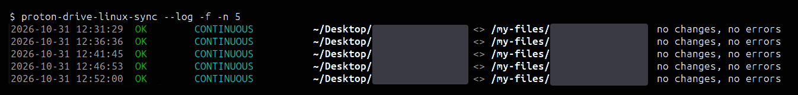

# Proton Drive Linux Sync

Proton Drive Linux Sync keeps local folders in sync with Proton Drive.
It's a Bash tool built on Proton's `proton-drive` CLI, with a terminal menu for setting things up and background sync through systemd or cron.

Each folder pair runs in one of three modes: two-way, upload only (a backup to Proton) or download only.

Continuous sync uploads local changes within seconds and checks Proton for remote changes at a regular interval.
Timed sync runs hourly, every 6 hours or daily instead.

> **Disclaimer:** this is an unofficial tool, not affiliated with or endorsed by Proton AG.
> Keep backups of important data, and try it on files you can afford to lose first.

## Requirements

- Debian or a Debian-based distribution like Ubuntu, since setup installs packages with `apt`.
- Proton's `proton-drive` CLI, logged in with `proton-drive auth login`.
- A systemd user session for continuous sync. Without one, timed sync uses cron.

## Setup

```bash
git clone https://github.com/berksudan/proton-drive-linux-sync.git
cd proton-drive-linux-sync
./scripts/setup.sh
```

The setup script installs `dialog`, `inotify-tools`, `jq`, `libnotify-bin` and `yq`.
It then creates `settings.yaml` from `settings.example.yaml`, turns on continuous sync and installs the `proton-drive-linux-sync` command.

The installed command runs straight from this repo, so leave the repo where it is.
If you move it, run `scripts/setup.sh` again.

## First Sync

1. Run `proton-drive-linux-sync` to open the menu.
2. Open **Folder pairs** and add a local folder, a Proton folder (starting with `/my-files`) and a mode.
3. Choose **Preview sync** to see what the first sync will upload, download or skip.
4. Choose **Sync now**.

The first sync of a pair copies files that exist on only one side to the other, and deletes nothing.
Continuous sync takes over from there.

## Usage

```bash
proton-drive-linux-sync              # open the menu
proton-drive-linux-sync --status     # show folder pairs, last results and automatic sync
proton-drive-linux-sync --log        # show the last 20 sync runs (-n 100 for more)
proton-drive-linux-sync --dry-run    # show what a sync would change, without changing anything
proton-drive-linux-sync --headless   # sync every folder pair without the menu
proton-drive-linux-sync --help       # list every option
```

`--log` lists each run's time, result, trigger, folder pair and changes, in colour in a terminal; add `-f` to keep watching for new runs:



Your settings are in `settings.yaml`, and `settings.example.yaml` describes each one with its default.
Sync history, logs and the local trash are in `~/.local/state/proton-drive-linux-sync`.

## Sync Modes

| Mode | What it does |
|---|---|
| Two-way | Changes, moves and deletions go both ways. |
| Upload only | Uploads new and changed local files. It never deletes or downloads anything, and the local version wins when a file changed on both sides. |
| Download only | Downloads new and changed Proton files. It never uploads or deletes local files, and the Proton version wins when a file changed on both sides; the local copy goes to the local trash. |

## Safety

- A sync asks before it deletes more than 50 files or more than 25% of a pair's files. Background syncs stop instead and wait for you to confirm from the menu (**Sync now**). Both limits are in Settings.
- Local files that a sync deletes go to a local trash, which you can restore from with **Restore deleted files**. Files deleted on Proton go to Proton's own trash.
- If a pair's local folder is suddenly empty or missing (an unplugged drive, a new computer), the sync stops before changing anything. The menu then offers to download everything from Proton again.
- If the Proton listing comes back empty while sync history exists, the sync stops too, so an expired login can't wipe your local files.
- When a file changed on both sides, the menu asks what to keep: local, Proton, both or neither. Keeping both saves the Proton version beside yours as `name.remote.ext`. Background syncs skip conflicts unless you pick a default in Settings.

## How It Works

After each sync, the tool saves a snapshot of every file's size and modification time on both sides.
The next sync compares both sides with that snapshot to tell which side changed, so it knows whether to upload, download, delete or flag a conflict.
A file that was moved or renamed on one side is moved on the other instead of being transferred again.

## Limitations

- Proton Docs aren't synced, because they can't be downloaded as regular files. The preview lists them under **Not synced**.
- Change detection uses size and modification time, not file contents. Two different edits that leave a file with the same size and modification time look the same.
- Continuous sync sees local changes within seconds, but sees changes made on Proton (from another computer, say) only at its regular check, every 15 minutes by default.
- systemd runs automatic sync only while you're logged in. To keep it running after you log out, run `loginctl enable-linger`.

## Troubleshooting

**Continuous sync stops with "the file watcher stopped".**
Very large folders can go over the system's limit on watched folders, and `~/.local/state/proton-drive-linux-sync/watch.log` says so.
Raise the limit, or switch to timed sync:

```bash
echo fs.inotify.max_user_watches=524288 | sudo tee /etc/sysctl.d/90-inotify.conf
sudo sysctl --system
```

**A sync keeps re-downloading everything, or its history looks wrong.**
Open **Folder pairs**, pick the pair and choose **Start fresh**, or run `proton-drive-linux-sync --headless --start-fresh --pair N`.
The next sync then behaves like a first sync and deletes nothing.

## Credits

This project started as [justinsloan/proton-drive-sync](https://github.com/justinsloan/proton-drive-sync) and was split into modules.
It's licensed under MIT; see [LICENSE](LICENSE).
